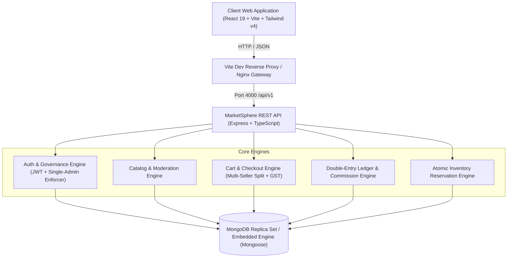

<div align="center">

# MarketSphere

**Enterprise Multi-Vendor E-Commerce Platform & Financial Ledger Engine**

*Designed for High-Concurrence Marketplace Operations with Indian GST & INR Minor-Unit Precision*

[](https://nodejs.org/)
[](https://www.typescriptlang.org/)
[](https://react.dev/)
[](https://expressjs.com/)
[](https://www.mongodb.com/)
[](https://tailwindcss.com/)
[](https://vitejs.dev/)
[](#testing--quality-assurance)
[](#)

</div>

---

## Executive Summary

**MarketSphere** is a production-grade, multi-vendor marketplace platform engineered for the Indian digital economy. The platform delivers an end-to-end e-commerce ecosystem featuring multi-seller checkout splitting, double-entry financial ledger accounting, tiered marketplace commissions, inventory reservation concurrency controls, and institutional-grade role governance.

Built with clean architecture principles, MarketSphere enforces zero penny-drop rounding errors by tracking all monetary values as integer minor units (**Paise**; 100 Paise = ₹1 INR).

---

## System Architecture



---

## Core Capabilities & Architectural Pillars

### 1. Role Governance & Single-Admin Guarantee
- **Public Customer & Seller Onboarding**: Public registration provides an intuitive role selection flow between **Customer** (buyer) and **Seller** (merchant). Registering as a Seller automatically provisions an approved merchant profile and digital storefront.
- **Strict Single-Admin Invariant**: The platform strictly enforces that **only one Administrator account** may exist. This is verified at the database schema level via a Mongoose `pre('save')` validation hook, rejecting any concurrent or subsequent admin creations.
- **Restricted Admin Provisioning**: Administrator creation is completely decoupled from public registration. The master administrator account can only be initialized via a secure server setup endpoint requiring a cryptographic secret (`ADMIN_SETUP_KEY`) or direct CLI execution (`npm run create-admin`).
- **Comprehensive User Governance**: Administrators can inspect all platform accounts, toggle account blocks, and promote/demote accounts between Customer and Seller roles. The primary Administrator account is permanently protected from demotion, blocking, or role tampering.

### 2. Multi-Vendor Order Splitting & Fulfillment
- **Unified Multi-Seller Cart**: Customers can seamlessly purchase items from multiple independent vendors in a single checkout transaction.
- **Sub-Order Dispatch**: Orders are automatically partitioned into vendor-specific **Sub-Orders**, providing each merchant with isolated fulfillment tracking, packing slip generation, and dispatch state machines.

### 3. Double-Entry Accounting & Escrow Ledger
- **Financial Balance Invariant**: All transactions generate balanced debit and credit entries across customer payables, marketplace escrow holdings, platform commission accounts, and vendor payout ledgers.
- **Tiered Commission Precedence Hierarchy**: Platform take rates are resolved dynamically using a 3-tier precedence matrix:
  1. *Priority 1*: Seller VIP Override rate.
  2. *Priority 2*: Category-specific commission tier.
  3. *Priority 3*: Marketplace default rate.
- **Exact Penny Precision**: Discount apportioning and partial refund reversals are split between vendor deductions and marketplace commission reversals with zero lost cents.

### 4. Indian Taxation & Localization Engine
- **GST Compliance**: Integrated 18% Goods & Services Tax (GST) quotation engine calculating tax components with integer paise precision.
- **Localized Thresholds**: Configurable dynamic shipping logic (e.g., standard ₹49 delivery, free delivery on orders ₹999+) and targeted promotional vouchers (e.g., `SAVE25` coupons).

---

## Repository Structure

```
marketsphere/
├── marketsphere-backend/         # Node.js + Express REST API Server
│   ├── src/
│   │   ├── models/               # Mongoose Schemas & Single-Admin Invariants
│   │   ├── lib/                  # Business Logic: Ledger, Commissions, Auth Tests
│   │   ├── api.ts                # REST API Routing & Controller Endpoints
│   │   ├── auth.ts               # JWT Session Management & Admin Provisioning
│   │   ├── db.ts                 # Database Connection & Seed Pipeline
│   │   └── server.ts             # Server Bootstrapper & Middleware Stack
│   ├── scripts/                  # Administrative Utilities (create-admin, smoke-test)
│   └── package.json              # Backend Dependencies & Scripts
│
├── marketsphere-frontend/        # React 19 Single Page Application
│   ├── src/
│   │   ├── components/           # UI Components (AdminDashboard, LoginModal, etc.)
│   │   ├── lib/                  # API Client, Session Refresh, and Formatters
│   │   ├── types/                # Strict TypeScript Contract Definitions
│   │   ├── App.tsx               # Root State Manager & View Router
│   │   └── main.tsx              # Application Entrypoint
│   ├── vite.config.ts            # Vite Configuration & Backend Proxy Rules
│   └── package.json              # Frontend Dependencies & Scripts
│
└── README.md                     # Monorepo Documentation
```

---

## Quick Start Guide

### Prerequisites
- **Node.js**: `v20.19.0` or higher (`v22.x` recommended)
- **Package Manager**: `npm` (included with Node.js)
- **Database**: Zero external setup required. The backend automatically boots an internal embedded MongoDB replica set if no remote URI is configured.

---

### Step 1: Launch the Backend API

Open a terminal and navigate to the backend directory:

```bash
cd marketsphere-backend

# Install dependencies
npm install

# Initialize local environment configuration
cp .env.example .env     # On Windows Command Prompt: copy .env.example .env

# Start the development server with live reload
npm run dev
```

The API will initialize and listen at **`http://localhost:4000/api/v1`**. On first boot, the system automatically runs the demo database seeder in memory.

---

### Step 2: Launch the Frontend Web Application

Open a second terminal and navigate to the frontend directory:

```bash
cd marketsphere-frontend

# Install dependencies
npm install

# Start the Vite development server
npm run dev
```

The web application will be accessible at **`http://localhost:5173`**. In development mode, Vite transparently proxies all `/api` requests to the backend server at port `4000`.

---

## Pre-Configured Demonstration Personas

For evaluation and testing, the database is automatically seeded with verified demo accounts across all platform roles:

| Role | Persona / Name | Email | Password | Access Capabilities |
|:---|:---|:---|:---|:---|
| **Administrator** | Aarav Patel (Admin) | `admin@marketsphere.in` | `Demo@12345` | Platform Administration, Role Governance, Commission Rules, Audit Logs |
| **Seller** | Rajesh Sharma (Apex Electronics) | `seller@apexelectronics.com` | `Demo@12345` | Merchant Storefront, Inventory Management, Sub-order Fulfillment |
| **Seller** | Ananya Desai (Lumina Living) | `seller@luminaliving.com` | `Demo@12345` | Merchant Storefront, Product Catalog Management |
| **Customer** | Sarah Connor | `customer@example.com` | `Demo@12345` | Storefront Browsing, Multi-Seller Cart, Order Tracking, Reviews |

> [!NOTE]
> When signing in via the web interface, enter the credentials above or select the preferred demo persona shortcut.

---

## Administration & CLI Utilities

### Creating the First Production Administrator
In production deployments, automatic demo seeding is disabled. Create the primary administrator account using the secure administrative CLI tool:

```bash
cd marketsphere-backend
npm run create-admin -- admin@yourcompany.com "System Administrator"
```
*The command will prompt interactively for a secure password (minimum 12 characters).*

### Resetting and Re-seeding Demo Data
To restore the platform to a clean demonstration state:

```bash
cd marketsphere-backend
npm run db:reset
```

---

## Production Configuration & Deployment

### Environment Variables Matrix (`marketsphere-backend/.env`)

| Variable | Description | Default / Recommended |
|:---|:---|:---|
| `PORT` | HTTP port for the Express application server | `4000` |
| `NODE_ENV` | Runtime environment (`development` / `production`) | `development` |
| `MONGODB_URI` | Remote MongoDB connection string (must support replica sets) | *(Empty: uses local embedded Mongo)* |
| `JWT_ACCESS_SECRET` | Cryptographic secret for signing access tokens | `32+ character random string` |
| `JWT_REFRESH_SECRET` | Cryptographic secret for signing refresh tokens | `32+ character random string` |
| `ADMIN_SETUP_KEY` | Secret key for the restricted `/api/v1/auth/setup-admin` endpoint | *(Configurable secret)* |
| `CORS_ORIGINS` | Permitted cross-origin origins (comma-delimited) | `http://localhost:5173` |

### Production Deployment Checklist
1. **Database**: Configure a MongoDB Atlas cluster or self-hosted replica set (required for multi-document ACID transactions).
2. **Secrets**: Set strong, high-entropy values for `JWT_ACCESS_SECRET`, `JWT_REFRESH_SECRET`, and `ADMIN_SETUP_KEY`.
3. **Payments**: By default, the payment gateway operates in sandbox evaluation mode. Integrate production webhooks (e.g., Razorpay / Stripe) before processing real customer transactions.
4. **Proxy**: Set `TRUST_PROXY=1` when deploying behind AWS ALB, Cloudflare, or Nginx reverse proxies.

---

## Testing & Quality Assurance

The codebase includes comprehensive test suites spanning financial ledger consistency, inventory concurrency, and role enforcement invariants:

```bash
cd marketsphere-backend

# Execute the unit and integration test suite
npm test
```

### Test Coverage Highlights
- **Role Invariant Tests**: Confirms that public registration cannot escalate privileges to `ADMIN`, validates the single-admin database barrier, and tests role swapping between `CUSTOMER` and `SELLER`.
- **Ledger Invariant Tests**: Verifies zero-sum balanced transactions (Debits == Credits) on order placement and refund reversals.
- **Commission Precedence Tests**: Confirms accurate hierarchy resolution across vendor, category, and platform-wide take rates.
- **Inventory Concurrency Tests**: Asserts that atomic reservation holds prevent stock overselling under parallel customer checkouts.

---

## Technology Stack

| Layer | Technology |
|:---|:---|
| **Frontend Framework** | React 19, TypeScript, Vite 8 |
| **Styling & UI** | Tailwind CSS v4, Framer Motion, Lucide Icons |
| **Backend Runtime** | Node.js (v20+), Express 4, TypeScript |
| **Database & ODM** | MongoDB Replica Set, Mongoose 9 |
| **Security & Auth** | JSON Web Tokens (JWT), httpOnly Cookie Rotation, Bcrypt.js, Helmet, Zod |
| **Testing** | Node.js Test Runner, In-Memory Mongo Replica Server |

---

<div align="center">
<sub>Built with precision for scalable e-commerce infrastructure. MarketSphere Platform &copy; 2026.</sub>
</div>
